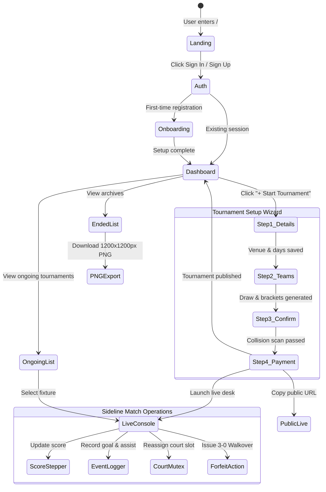

# Play Field: App Flow & Design Brief
### UI/UX Design System, Screen Architecture & Visual Artifacts
**Version:** 1.0.0 | **Design Language:** Stitch PitchSync UI Standard

---

## 1. Design System & Brand Identity

Play Field follows a high-contrast, broadcast-grade design language inspired by professional stadium LED scoreboards and pitchside tactical consoles.

### 1.1 Color Palette & Tokens

| Token Name | Hex Code | Role & Usage |
| :--- | :--- | :--- |
| **Pitch Turf Emerald** | `#0D6E4F` | Primary brand accent, primary CTA buttons, active state indicators. |
| **Floodlight Navy** | `#0B192C` | Broadcast mastheads, high-contrast table headers, dark surfaces. |
| **Signal Live Orange** | `#EA580C` | Live pulse badges, active clock timers, urgent match notifications. |
| **Canvas Alabaster** | `#F8FAFC` | Clean background canvas providing eye relief and high readability. |
| **Card White** | `#FFFFFF` | Elevated cards, forms, and standings surfaces. |
| **Card Red / Danger** | `#DC2626` | Disqualifications, conflict warnings, forfeit badges, card offenses. |
| **Status Warning Amber**| `#F59E0B` | Co-organizer security guard pill, pending approvals, walkover flags. |
| **Relocation Blue** | `#1D4ED8` | Court reassignment alerts and public relocation notice banners. |

### 1.2 Typography Hierarchy

Play Field loads four Google Fonts, each assigned to a distinct operational role:

| Font Family | Weight(s) | Primary Purpose |
| :--- | :--- | :--- |
| **Plus Jakarta Sans** | 600, 700, 800 | Section headers, card titles, navigation items. |
| **Barlow Condensed** | 700, 800 | Large broadcast scores, match countdown clocks, stadium banners. |
| **Instrument Sans** | 400, 500, 600 | Body text, explanations, form labels, player rosters. |
| **JetBrains Mono** | 500, 700 | Monospaced score steppers, fixture timestamps, court numbers, audit codes. |

### 1.3 Tactile Mobile Guidelines
- **Zero iOS Zoom**: All form `<input>` and `<select>` elements enforce `font-size: 16px` to avoid automatic browser zoom triggers on iPhones.
- **Minimum Tap Target**: All sideline score steppers, court selector buttons, and modal triggers maintain a minimum touch bounding box of **44×44px**.

---

## 2. End-to-End Application Flow

---

## 3. Screen Architecture & Visual Artifacts

Below are the actual production application screens captured during live verification:

### 3.1 Public Landing Page (`/`)
Showcases the core value proposition: integrated venue booking, conflict-free scheduling, and live spectator broadcast links.

---

### 3.2 Organizer Dashboard (`/dashboard`)
Serves as mission control for tournament directors. Features the primary CTA **"+ Start Tournament"**, active ongoing tournament previews with live court badges, and archived historical tournaments.

---

### 3.3 4-Step Tournament Creation Wizard: Structure & Conflict Confirmation (`/tournaments/new/confirm`)
Step 3 validates the complete tournament draw and runs the **Pre-Publish Court Collision Scan**, verifying zero overlapping fixtures across Courts 1, 2, and 5.

---

### 3.4 Selective Payment Options & Publication (`/tournaments/new/payment`)
Offers selective checkout options: **30% Advance Deposit** (`LKR 37,800`) to immediately lock the courts, or **100% Full Venue Package** (`LKR 126,000`). Upon payment, the tournament transitions to `PUBLISHED_ONGOING` and generates the public spectator link.

---

### 3.5 Sideline Live Management Console (`/tournaments/:id/manage`)
Pitchside operations console featuring:
- High-contrast score steppers (`[- / +]`).
- Roster-linked Goal and Assist drop-down selectors with minute tracking.
- Two-tier Court Reassignment modal (tested live: moving from Court 1 $\rightarrow$ Court 5).
- Disciplinary Desk with **Walkover (`WALKOVER`)** awarding automatic 3-0 forfeit wins.
- Automated Group A & B standings tables with FIFA tiebreaker sorting.

---

### 3.6 Public Live Spectator Broadcast (`/public/tournament/:id`)
Zero-login public stream displaying the live scoreboard, real-time match clock, live goalscorer feed, and the reactive **Official Venue Reassignment Notice Banner** (`Court 1 → Court 5: Turf conditioning & weather maintenance protocol`).

---

### 3.7 Concluded Tournaments Podium & High-Resolution PNG Export (`/tournaments/ended`)
Historical archive showcasing tournament champions (Apex Warriors), runners-up (Colombo Thunder FC), Golden Boot leaderboards, and the **"Download Stats & Events (.PNG)"** 1200×1200px graphics generator.

