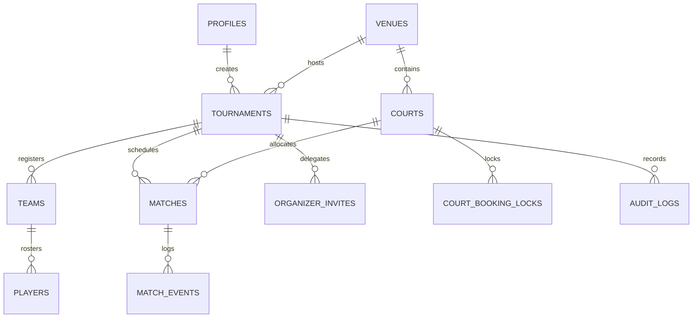
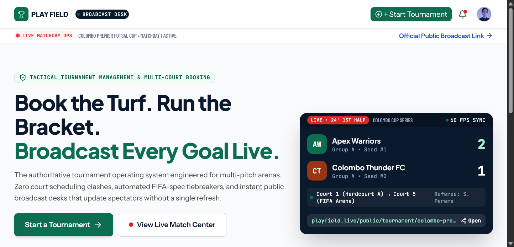
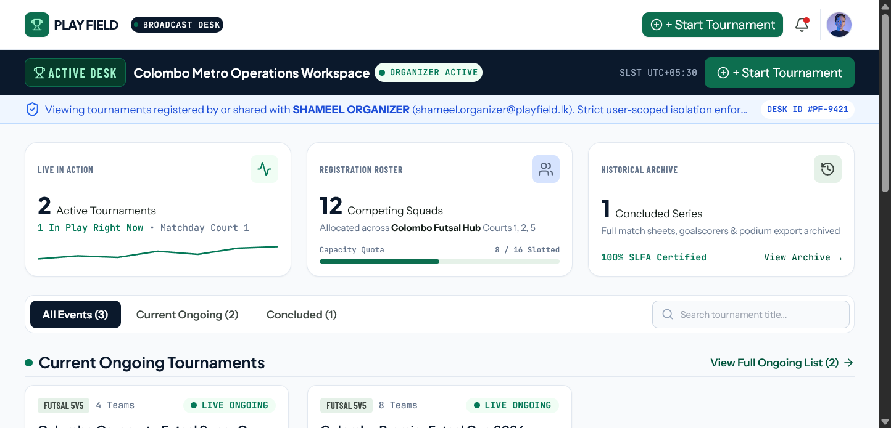
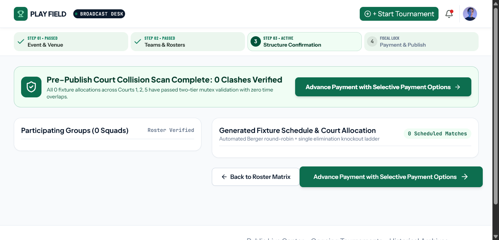
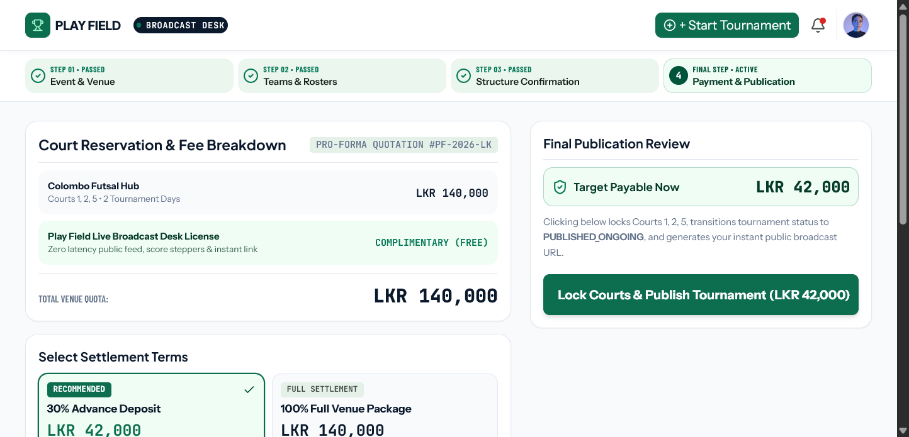
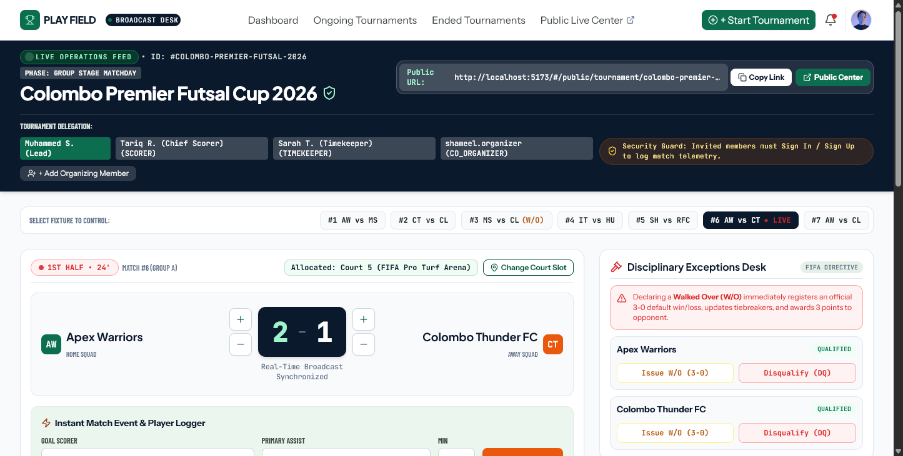
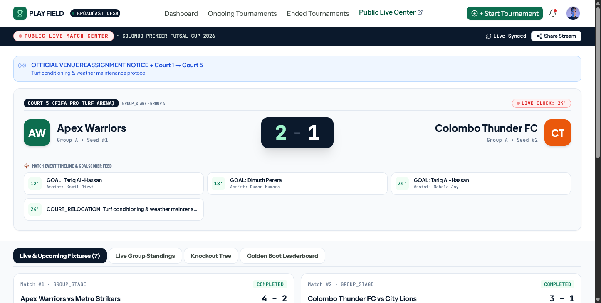
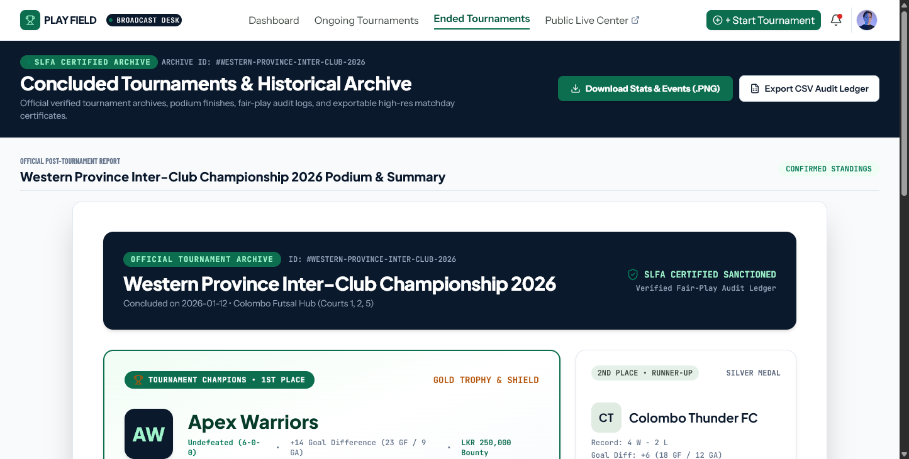

# Play Field: Comprehensive System Specification & Showcase
### Smart Sports Tournament Scheduling & Live Match Management Platform
**Repository:** [https://github.com/shameel-alt/Play-Field](https://github.com/shameel-alt/Play-Field) | **Database:** Supabase PostgreSQL 17 | **Status:** Production Ready

---

## 📑 Document Structure
1. [Executive Summary & Product Vision](#1-executive-summary--product-vision)
2. [Product Requirements Document (PRD) Summary](#2-product-requirements-document-prd-summary)
3. [Technical Requirements Document (TRD) & Database Architecture](#3-technical-requirements-document-trd--database-architecture)
4. [Algorithmic Domain Engines](#4-algorithmic-domain-engines)
5. [UI/UX Design System & Tactile Guidelines](#5-uiux-design-system--tactile-guidelines)
6. [Visual Screen Showcase & Evidence](#6-visual-screen-showcase--evidence)
7. [Process & Task Execution Log](#7-process--task-execution-log)

---

## 1. Executive Summary & Product Vision

Play Field is a responsive web application and tournament operating system built for multi-court sports facilities, pitchside directors, referees, and competing clubs. It translates the Stitch UI design system into a complete production platform with:
- **Zero Court Clashes**: Two-tier conflict mutex guaranteeing zero time overlaps across Courts 1 to 5 and venue maintenance locks.
- **Sideline Scorekeeping**: Real-time tactile score steppers with roster-linked goalscorer and assist tracking.
- **Automated Standings & Disciplinary Actions**: FIFA/AMF futsal standings calculation and 1-click 3-0 Walkovers.
- **Zero-Login Fan Broadcast**: Real-time public scoreboard with active match clocks and official court relocation notice banners.
- **High-DPI Social Graphics**: 1200×1200px tournament summary `.png` exports for social media.

---

## 2. Product Requirements Document (PRD) Summary

### 2.1 Core Routing & 13-Screen Specification
- **Screen 1: Landing Page (`/`)**: Value proposition and live preview links.
- **Screens 2 & 3: Sign In (`/login`) & Sign Up (`/signup`)**: Authentication with deep-link co-organizer delegation guards (`?inviteToken=...&tournamentId=...`).
- **Screen 4: Onboarding (`/onboarding`)**: Sport preferences & organizer profile setup.
- **Screen 5: Dashboard (`/dashboard`)**: Strict user filtering (`createdBy === user.id || coOrganizers.includes(user.email)`).
- **Screens 6–9: 4-Step Start Tournament Wizard**: Event details $\rightarrow$ Teams & rosters $\rightarrow$ Structure confirmation $\rightarrow$ Selective payment options (30% Advance Deposit vs 100% Full Package).
- **Screen 10: Ongoing Tournaments (`/tournaments/ongoing`)**: Dynamic next-match court and kickoff badges.
- **Screen 11: Live Management Console (`/tournaments/:id/manage`)**: Score steppers, player event loggers, Two-Tier Court Reassignment modal, and Walkover/Disqualification controls.
- **Screen 12: Ended Tournaments & PNG Export (`/tournaments/ended`)**: Podium accolades, Golden Boot leaderboards, and 1200×1200px PNG summary export.
- **Screen 13: Public Live Broadcast (`/public/tournament/:id`)**: Real-time spectator scoreboards and court relocation banners.
- **Screen 14: Co-Organizer Invite Gateway (`/invite/:token`)**: Invitation acceptance flow.

---

## 3. Technical Requirements Document (TRD) & Database Architecture

### 3.1 Tech Stack
- **Frontend**: React 18, Vite 6, TypeScript 5.7, Tailwind CSS 3.4, Lucide Icons.
- **Database**: Supabase PostgreSQL 17 with 11 relational tables and Realtime channels.
- **Exporting**: `html-to-image` configured with `skipFonts: true` and `pixelRatio: 2`.

### 3.2 11-Table Relational Schema

---

## 4. Algorithmic Domain Engines

1. **Berger Pairings Engine** ([`src/lib/tournamentEngine.ts`](file:///c:/Elvian%20(DO%20NOT%20DELETE)/Shameel/src/lib/tournamentEngine.ts)): Cyclic round-robin generator with rest-time buffer scheduling.
2. **Two-Tier Court Collision Mutex** ([`src/lib/conflictEngine.ts`](file:///c:/Elvian%20(DO%20NOT%20DELETE)/Shameel/src/lib/conflictEngine.ts)): Tier 1 intra-tournament fixture collision; Tier 2 venue-wide maintenance lock.
3. **FIFA Standings Engine** ([`src/lib/standingsEngine.ts`](file:///c:/Elvian%20(DO%20NOT%20DELETE)/Shameel/src/lib/standingsEngine.ts)): Calculates Points ($3W + 1D$), GD, GF, and cascading head-to-head tiebreakers.
4. **Disciplinary & Forfeit Engine** ([`src/lib/forfeitEngine.ts`](file:///c:/Elvian%20(DO%20NOT%20DELETE)/Shameel/src/lib/forfeitEngine.ts)): Automatic 3-0 Walkover wins and Disqualification exclusions.
5. **High-DPI PNG Exporter** ([`src/lib/exportEngine.ts`](file:///c:/Elvian%20(DO%20NOT%20DELETE)/Shameel/src/lib/exportEngine.ts)): 1200×1200px export engine bypassing cross-origin font CSS security errors.

---

## 5. UI/UX Design System & Tactile Guidelines

- **Pitch Turf Emerald** (`#0D6E4F`): Primary CTA and pitch turf branding.
- **Floodlight Navy** (`#0B192C`): Stadium broadcast mastheads and dark cards.
- **Signal Live Orange** (`#EA580C`): Live pulses and active timers.
- **Canvas Alabaster** (`#F8FAFC`): Eye-friendly neutral canvas.
- **Card Red / Danger** (`#DC2626`): Disqualifications and conflict warnings.
- **Mobile Rule**: 16px input font size (prevents iOS auto-zoom) and 44×44px minimum tap targets.

---

## 6. Visual Screen Showcase & Evidence

### 6.1 Landing Page

### 6.2 Tournament Director Dashboard

### 6.3 4-Step Wizard: Structure & Conflict Scan

### 6.4 Selective Payment Checkout

### 6.5 Sideline Live Management Console

### 6.6 Public Live Spectator Broadcast

### 6.7 Concluded Tournaments Podium & PNG Export

---

## 7. Process & Task Execution Log

| Phase | Description | Deliverables & Verification |
| :--- | :--- | :--- |
| **Phase 1** | Planning & Technical Architecture | Complete PRD, TRD, and 13-screen architecture plan |
| **Phase 2** | Supabase Relational Schema Deployment | 11 PostgreSQL tables deployed via Supabase MCP |
| **Phase 3** | Scaffolding & Modular Styling | Multi-file CSS tokens, Google Fonts, and Tailwind setup |
| **Phase 4** | Domain Engines & Seed Data | Berger pairings, 2-tier mutex, standings, and seed datasets |
| **Phase 5** | State Stores & Context | `AuthContext` and `TournamentContext` with strict user filtering |
| **Phase 6** | 14 Core Views & Components | Full suite of React components and views |
| **Phase 7** | Live Verification via DevTools MCP | Tested court reassignment, Walkover 3-0, PNG download, and build (`0 errors`) |
| **Phase 8** | GitHub Repository Sync | Synchronized with `https://github.com/shameel-alt/Play-Field` |
| **Phase 9** | Documentation & PDF Publishing | Executive PRD, TRD, App Flow, and Master Dossier in PDF format |
