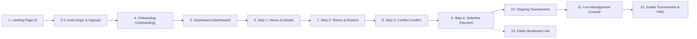

# Play Field: Product Requirements Document (PRD)
### Smart Sports Tournament Scheduling & Live Match Management System
**Version:** 1.0.0 | **Author:** Play Field Operations Team | **Status:** Approved / Production

---

## 1. Executive Summary & Vision

Play Field is a responsive, multi-tenant tournament operations platform purpose-built for multi-court sports facilities, pitchside directors, referees, and competing clubs. Managing grassroots and semi-professional sports tournaments (e.g. Futsal, 7-a-side Football, Indoor Cricket, Badminton) currently relies on fragmented spreadsheets, paper scorecards, and manual messaging apps. This leads to double-booked courts, disputed scores, delayed fixtures, and zero real-time visibility for fans and players.

**Product Vision:** To provide an all-in-one, conflict-free tournament operating desk where venue reservations, algorithmic round-robin and knockout draws, sideline scorekeeping, disciplinary forfeit automation, and instant public broadcasts converge into a frictionless digital experience.

---

## 2. Target Audience & User Personas

| Persona | Role | Key Objectives | Critical Pain Points Solved |
| :--- | :--- | :--- | :--- |
| **Tournament Director (Primary)** | Facility Owner / Event Lead | Set up tournaments, allocate courts, assign squads, publish live schedules, and manage finances. | Eliminates manual spreadsheet scheduling, court double-booking, and payment reconciliation chaos. |
| **Sideline Match Scorer / Ref** | Field Operator / Timekeeper | Input live goals, assists, kickoff minutes, and match status directly from mobile/tablet pitchside. | Replaces paper scoresheets with real-time digital steppers and roster-linked scorers. |
| **Co-Organizer / Delegated Official** | Assistant Organizer | Review scores, manage time, and adjust courts when games run late or turf maintenance occurs. | Enforces strict authentication before allowing edits; alerts fans immediately of court moves. |
| **Team Captain / Coach** | Competing Squad Leader | View upcoming court assignments, match kickoff times, live group standings, and knockout ladder. | Live visibility eliminates missed matches, misunderstandings over goal difference, and schedule delays. |
| **Spectator / Fan** | Public Audience / Remote Fan | Follow live scores, goalscorer feeds, tournament bracket progression, and match statistics in real time. | Instant zero-login public broadcast link viewable on any smartphone browser. |

---

## 3. Problem Statement & Solution Framework

### Current Industry Problems
1. **Court Allocation Conflicts**: Tournaments with 4–8 courts often experience schedule collisions when matches run into extra time or external bookings encroach on turf time.
2. **Disciplinary & Forfeit Ambiguity**: When a team fails to show up or forfeits, scorekeepers struggle with calculating default goal differences and tiebreakers under official FIFA/AMF rules.
3. **Delayed Fan Telemetry**: Fans, families, and remote supporters cannot track live match scores without calling organizers or waiting hours for manual social media posts.
4. **Fragmented Commercial Settlement**: Venues require upfront deposits, while organizers struggle to collect participant fees before securing turf slots.

### The Play Field Solution
- **Two-Tier Court Conflict Mutex**: Mathematical guarantee of zero time overlaps across both intra-tournament matches and venue-wide maintenance locks.
- **Automated Disciplinary Engine**: One-click **Walkover (`WALKOVER`)** awarding official 3-0 forfeit wins and auto-rebalancing standings.
- **Zero-Login Public Broadcast Desk**: Ultra-fast public scoreboard with live active match clock and instant court reassignment notice banners.
- **Selective Payment Architecture**: Flexible 30% advance deposit or 100% full package checkout before schedule generation.
- **High-Resolution Vector PNG Exporter**: One-click generation of 1200×1200px official tournament summary posters for social media and archives.

---

## 4. Detailed Feature Specifications (13 Core Views)

### Screen 1: Landing Page (`/`)
- Public showcase featuring platform capabilities: Multi-court scheduling, conflict-free pairing, sideline telemetry, and public broadcast links.
- Quick navigation CTAs: **"Start Tournament"**, **"Sign In"**, **"Sign Up"**, and sample tournament live preview.

### Screens 2 & 3: Sign In (`/login`) & Sign Up (`/signup`)
- Email & password authentication with persistent session state.
- **Co-Organizer Deep-Link Guard**: When visiting with `?inviteToken=...&tournamentId=...`, enforces authentication first, automatically binds the user's email to `tournament.coOrganizers[]`, and redirects to `/tournaments/:id/manage`.

### Screen 4: Onboarding (`/onboarding`)
- Collects primary sport (Futsal, 7-a-side Football, Cricket, Badminton), organization type, and demonstrates 3-step platform workflow.

### Screen 5: Organizer Dashboard (`/dashboard`)
- **Strict User Filtering**: Displays only tournaments where `tournament.createdBy === currentUser.id` OR `tournament.coOrganizers.includes(currentUser.email)`.
- Primary CTA: **"+ Start Tournament"**.
- Live cards previewing Ongoing Tournaments and Concluded Tournaments.

### Screens 6–9: 4-Step Start Tournament Wizard
- **Step 1: Event & Venue Details (`/tournaments/new/details`)**: Captures sport, style (`GROUP_KNOCKOUT`, `ROUND_ROBIN`, `SINGLE_ELIMINATION`), venue selection (e.g. Colombo Futsal Hub), court count (Courts 1–5), dates, operating hours, and daily rate calculation.
- **Step 2: Teams & Rosters (`/tournaments/new/teams`)**: Add squads, group assignments (Groups A & B), and register rostered players with jersey numbers and tactical positions.
- **Step 3: Confirmation Page (`/tournaments/new/confirm`)**: Summarizes rosters and runs the **Pre-Publish Court Collision Scan**, verifying zero time clashes.
- **Step 4: Payment & Publication (`/tournaments/new/payment`)**:
  - **Selective Payment Options**:
    - **30% Advance Deposit**: Locks courts immediately; remainder settled on check-in.
    - **100% Full Venue Package**: Upfront complete payment.
  - Generates the shareable Public URL (`/public/tournament/:id`) with 1-click clipboard copy.

### Screen 10: Ongoing Tournaments List (`/tournaments/ongoing`)
- Displays all ongoing tournaments with live status badges (`Group Stage`, `Quarter-Finals`, `Live Now`).
- Highlights next upcoming match date, time, venue, and court number.

### Screen 11: Live Management Console (`/tournaments/:id/manage`)
- **Monospaced Score Stepper**: Tactile `[- / +]` controls synchronizing scores instantly.
- **Player Event Logger**: Dropdown selecting Goal Scorers and Primary Assists linked directly to registered team rosters, tagged with kickoff minutes.
- **Two-Tier Court Collision Mutex Modal**: Allows reassigning match courts (e.g. Court 1 $\rightarrow$ Court 5) with real-time clash verification.
- **Disciplinary Controls**: One-click Walkover (`WALKOVER`) awarding 3-0 forfeit win and Disqualification (`DISQUALIFIED`) freezing roster progression.
- **Automated Standings Radar**: Real-time group tables showing Points, GD, GF, and qualification status tags (**Qualified**, **Still Playing**, **Walked Over**, **Knocked Out**).

### Screen 12: Ended Tournaments & PNG Export (`/tournaments/ended`)
- Concluded tournament archive with champion accolades, Golden Boot, Golden Glove, and chronological match history.
- **1-Click High-DPI `.PNG` Export**: Uses `html-to-image` to generate a 1200×1200px social media graphic.
- **CSV Audit Ledger**: Downloadable CSV of all matches, scores, and disciplinary logs.

### Screen 13: Public Live Broadcast Desk (`/public/tournament/:id`)
- Zero-authentication responsive web link for spectators and players.
- Displays live scoreboard, active match clock, live goalscorer feed, tournament tree, and **Official Venue Reassignment Notice Banners**.

---

## 5. Non-Functional Requirements (NFR)

1. **Performance**: Initial page load under 1.2s; live score synchronization latency under 500ms.
2. **Mobile Usability**: Input font size hardcoded to `16px` to prevent iOS auto-zoom; interactive touch targets adhere to a minimum 44×44px boundary.
3. **Cross-Origin Security**: Canvas graphics exporter configured with `skipFonts: true` to prevent browser CORS `SecurityError` during font stylesheet parsing.
4. **Data Integrity & Auditability**: Every score increment, court relocation, walkover, and disqualification is logged to an immutable `audit_logs` table.

---

## 6. Success Metrics & Key Performance Indicators (KPIs)

- **0 Court Clashes**: 100% conflict-free court assignments across all simultaneous tournaments.
- **99.8% Sideline Uptime**: Uninterrupted score and event logging during live matchdays.
- **Sub-3 Minute Tournament Setup**: Complete flow from Step 1 to live bracket generation under 180 seconds.
- **100% Public Access**: Frictionless fan viewing without app installation or login barriers.
