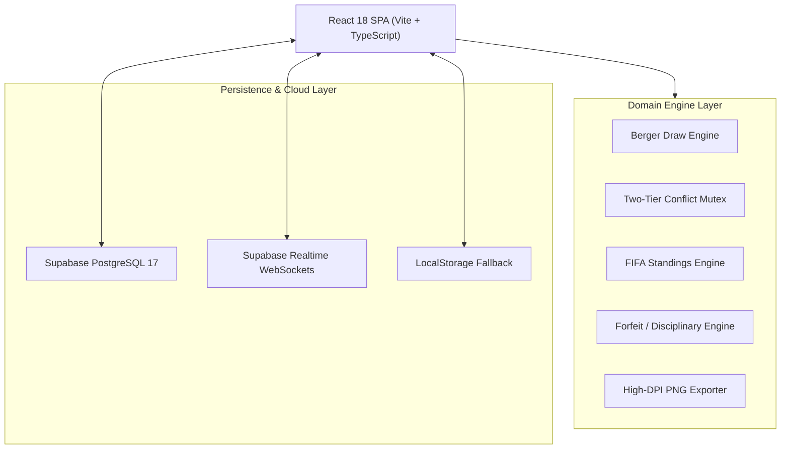

# Play Field: Technical Requirements Document (TRD)
### Architectural Blueprint, Database Schema & Algorithmic Engines
**Version:** 1.0.0 | **Target Runtime:** React 18, Vite 6, Supabase PostgreSQL 17

---

## 1. System Architecture & Topology

Play Field is engineered with a modular client-server architecture:
- **Presentation Layer**: React 18 SPA built with Vite 6 and TypeScript 5.7.
- **Design & Styling Engine**: Tailwind CSS 3.4 with custom CSS token modules and Google Fonts (`Plus Jakarta Sans`, `Barlow Condensed`, `Instrument Sans`, `JetBrains Mono`).
- **Domain Algorithmic Engines**: Pure TypeScript modules executing deterministic bracket generation, two-tier collision checks, FIFA standings recalculation, and high-DPI canvas rendering.
- **State & Persistence**: Client-side context stores (`AuthContext`, `TournamentContext`) synchronizing with **Supabase PostgreSQL 17** via REST/Realtime channels, backed by localStorage fallback caching.



---

## 2. Supabase PostgreSQL 17 Relational Schema

The database consists of 11 relational tables provisioned with foreign keys, checks, and audit indexes:

### 2.1 Schema Definition Table Matrix

| Table Name | Primary Key | Description | Key Relationships |
| :--- | :--- | :--- | :--- |
| `profiles` | `id` (UUID) | Registered tournament directors, scorers, and referees | References `auth.users(id)` |
| `venues` | `id` (UUID) | Multi-court sports complexes (e.g. Colombo Futsal Hub) | 1:N with `courts` |
| `courts` | `id` (UUID) | Individual physical courts (Court 1 to Court 5) with surface types | References `venues(id)` |
| `tournaments` | `id` (UUID) | Core tournament entity with status, dates, and budget | References `venues(id)`, `profiles(id)` |
| `teams` | `id` (UUID) | Registered competing clubs assigned to Group A or B | References `tournaments(id)` |
| `players` | `id` (UUID) | Individual squad members with jersey numbers and positions | References `teams(id)` |
| `matches` | `id` (UUID) | Scheduled fixtures with start/end time, scores, and status | References `tournaments(id)`, `courts(id)` |
| `match_events` | `id` (UUID) | Granular match events (GOAL, ASSIST, YELLOW_CARD, RED_CARD) | References `matches(id)`, `players(id)` |
| `court_booking_locks` | `id` (UUID) | External venue maintenance slots and private bookings | References `courts(id)` |
| `organizer_invites` | `id` (UUID) | Delegation tokens for co-organizers and scorers | References `tournaments(id)` |
| `audit_logs` | `id` (UUID) | Immutable event ledger tracking score updates & court changes | References `tournaments(id)` |

---

## 3. Algorithmic Domain Engines

### 3.1 Berger Round-Robin & Knockout Generation Engine
**File:** [`src/lib/tournamentEngine.ts`](file:///c:/Elvian%20(DO%20NOT%20DELETE)/Shameel/src/lib/tournamentEngine.ts)
- **Algorithm**: Implements the cyclic Berger rotation algorithm to generate balanced home/away pairings across squads in each group:
  $$\text{Rounds} = N - 1 \quad (\text{if } N \text{ is even})$$
  $$\text{Matches per round} = \frac{N}{2}$$
- **Rest Interval Guarantee**: Distributes court assignments cyclically (`court 1`, `court 2`, `court 5`) while enforcing minimum rest intervals between consecutive matches for any single team.
- **Knockout Bracket**: Constructs single elimination paths:
  - Semi-Final 1: $\text{Winner Group A} \text{ vs } \text{Runner-Up Group B}$
  - Semi-Final 2: $\text{Winner Group B} \text{ vs } \text{Runner-Up Group A}$
  - Final: $\text{Winner SF1} \text{ vs } \text{Winner SF2}$

### 3.2 Two-Tier Court Conflict Mutex Engine
**File:** [`src/lib/conflictEngine.ts`](file:///c:/Elvian%20(DO%20NOT%20DELETE)/Shameel/src/lib/conflictEngine.ts)
Ensures zero schedule overlap using two validation tiers:
- **Tier 1 (Intra-Tournament Clashes)**: Validates against concurrent fixtures within the same tournament:
  $$\text{Overlap} \iff (\text{Court}_A = \text{Court}_B) \land (S_A < E_B) \land (E_A > S_B)$$
- **Tier 2 (Inter-Tournament / Venue-Wide Locks)**: Validates against external maintenance slots, private league reservations, and turf renovations in `court_booking_locks`.
- **Automated Alternate Suggestion**: If a collision is detected on the requested court, the engine scans all remaining venue courts and suggests the first available conflict-free slot.

### 3.3 FIFA/AMF Futsal Standings Engine
**File:** [`src/lib/standingsEngine.ts`](file:///c:/Elvian%20(DO%20NOT%20DELETE)/Shameel/src/lib/standingsEngine.ts)
Calculates real-time group tables using standard international tournament rules:
$$\text{Points} = 3 \times W + 1 \times D + 0 \times L$$
$$\text{Goal Difference (GD)} = \text{GF} - \text{GA}$$
- **Cascading Tiebreaker Order**:
  1. Points ($\text{PTS}$)
  2. Head-to-Head Result ($\text{H2H}$)
  3. Goal Difference ($\text{GD}$)
  4. Goals For / Scored ($\text{GF}$)
- **Dynamic Status Tags**: Evaluates whether a team is **Qualified**, **Still Playing**, **Walked Over**, or **Knocked Out**.

### 3.4 Forfeit & Disciplinary Engine
**File:** [`src/lib/forfeitEngine.ts`](file:///c:/Elvian%20(DO%20NOT%20DELETE)/Shameel/src/lib/forfeitEngine.ts)
- **Walkover (`WALKOVER`)**: When a squad fails to report within the 15-minute official grace period:
  - Match is marked with status `WALKOVER`.
  - Non-forfeiting team is awarded an automatic **3–0 victory** and +3 points.
  - Forfeiting team is assigned 0 points, 0 GF, and 3 GA (GD $-3$).
  - Emits an immutable audit log entry: `WALKOVER: <Forfeiting Team> defaulted`.
- **Disqualification (`DISQUALIFIED`)**: Freezes team eligibility across current and future fixtures, revoking playoff advancement.

### 3.5 High-Resolution Vector PNG Export Engine
**File:** [`src/lib/exportEngine.ts`](file:///c:/Elvian%20(DO%20NOT%20DELETE)/Shameel/src/lib/exportEngine.ts)
- Renders the dedicated 1200×1200px `#tournament-export-canvas` component using `html-to-image`.
- **CORS Mitigation**: Configured with `skipFonts: true` and `pixelRatio: 2` to bypass cross-origin security restrictions on remote Google Fonts stylesheets, delivering crisp print-ready 2400×2400px effective raster images.

---

## 4. State Management & API Contracts

### 4.1 State Stores
- **`AuthContext`**: Manages `currentUser`, session token persistence in `localStorage`, and multi-mode invite token detection:
  ```typescript
  // Extracts token from both standard query and hash URLs
  const searchParams = new URLSearchParams(window.location.search);
  const hashIndex = window.location.hash.indexOf('?');
  const hashParams = hashIndex !== -1 ? new URLSearchParams(window.location.hash.substring(hashIndex + 1)) : null;
  const inviteToken = searchParams.get('inviteToken') || hashParams?.get('inviteToken');
  ```
- **`TournamentContext`**: Enforces strict user filtering, score steppers, goal/assist telemetry, court reassignment mutex validation, and Walkover/DQ handling.

### 4.2 Security & Authentication Guard
- Invited co-organizers navigating to `/login?inviteToken=...&tournamentId=...` are strictly barred from modifying fixtures until they sign in or sign up. Upon successful authentication, the backend binds their account to `tournament.coOrganizers[]` and redirects to `/tournaments/:id/manage`.
